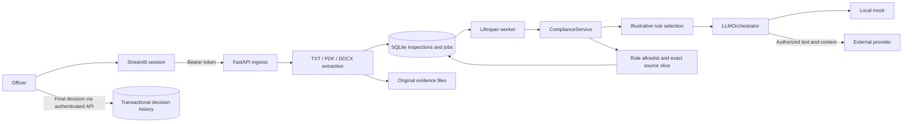

# ComplianceAI architecture

The supported topology is one FastAPI process on a trusted workstation and one Streamlit frontend. All enrolled officers share the local inspection workspace.

## Inspection and review

1. Sign-in checks the separate SQLite officer registry and returns a one-hour process-local session. API ingress verifies the session before parsing protected request bodies.
2. Upload validates file size, name, format and extraction bounds. Accepted bytes receive a UUID-prefixed filename. A transaction records canonical text, chunk offsets, evidence digest and queued job. HTTP 202 includes a pollable status URL. Upload acknowledgment includes extraction. An optional idempotency key binds file type and bytes.
3. The worker atomically claims QUEUED work as PROCESSING. Each eligible target gets selected rule summaries and bounded surrounding text. A matching checkpoint can serve the candidate list. Live provider requests use quota pacing. A provider delay is visible as WAITING_FOR_QUOTA within PROCESSING.
4. Validation checks candidate schema, supplied rule ID and exact target-local quotation. Each verified passage equals the canonical Python string slice at its half-open offsets. Overlapping or repeated text demands inspection of offsets. The application deduplicates matching rule and offset pairs.
5. Final findings, validation history and COMPLETED status commit together. A failure yields FAILED. Eligible failed, unsigned jobs can retry under the same ID using verified evidence. Startup requeues interrupted work. A crash before checkpoint commit can repeat a provider request.
6. A completed inspection can receive one authenticated human decision. Signed snapshot and attributed history commit together. Status completion, valid evidence and a human approval each describe different facts.

## Persistence and trust

The original document and the SQLite snapshot cross separate filesystem write boundaries. An interrupted upload can leave an unmatched original. Preserve these files for operator reconciliation. Review history has database-level mutation protections. Backups include documents and officer password digests. Local OS administrators control the files. Deployment controls and operator procedures are in SECURITY.md and README.md.
